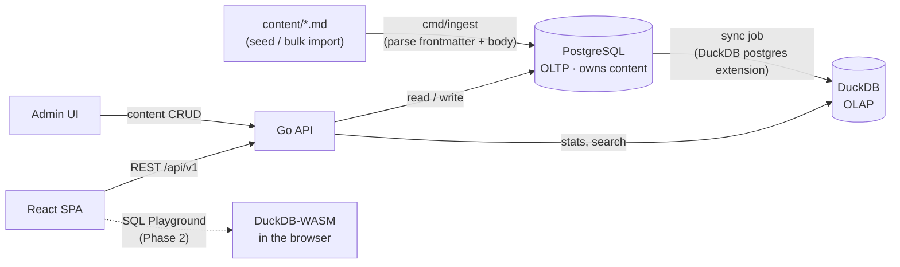

# Architecture

> Status: Phase 0 (skeleton). This document describes the **target** design; see
> [roadmap.md](roadmap.md) for what is built so far.

## Goals

The hub serves one purpose: **store, learn and practice Data Engineering knowledge**.

1. **Second brain** — write notes fast, find them again.
2. **Learning roadmap** — follow an ordered path and track progress.
3. **Interview prep + labs** — quizzes, flashcards, SQL practice, runnable labs.
4. **Portfolio** — hosted publicly later, so the backend is built properly from day one.

A secondary goal is **learning the tech stack itself** (Go, React, PostgreSQL, DuckDB).

## Stack

| Layer | Choice | Why |
|---|---|---|
| Frontend | React + Vite + TypeScript | Modern SPA; Vite instead of Next.js because the backend is a separate Go service |
| Backend | Go, `net/http` + [chi](https://github.com/go-chi/chi), `log/slog` | Small, explicit, close to the standard library |
| OLTP store | PostgreSQL ([pgx](https://github.com/jackc/pgx)) | App data: notes, users, progress, quiz attempts — see [ADR-0001](adr/0001-postgres-oltp-duckdb-olap.md) |
| OLAP store | DuckDB | Analytics, full-text search, SQL playground datasets |
| Content | PostgreSQL (`books`, `chapters`); Markdown in `content/` is the import format | Admins edit content in the UI — see [ADR-0003](adr/0003-postgres-owns-content.md) |
| Local infra | Docker Compose | One command to start Postgres (and later lab services) |
| CI | GitHub Actions | gofmt, vet, test, build + eslint, build |

## Data flow



- **Write path (OLTP):** admins create and edit books/chapters through the API; `cmd/ingest`
  seeds or bulk-imports Markdown. User actions (progress, quiz attempts) also go to Postgres.
  Many small transactions → row store.
- **Read/analyze path (OLAP):** a sync job copies Postgres tables into DuckDB; the API
  queries DuckDB for aggregations ("weakest topics this month") and search. Few big
  scans → column store.
- **SQL Playground:** runs DuckDB-WASM *in the browser*, so untrusted user SQL never
  executes on the server.

This mirrors a real data platform in miniature: **source system (OLTP) → pipeline → warehouse (OLAP)**.

## Repository layout

```
Knowledge-DE-HUB/
├── backend/            Go module
│   ├── cmd/api/        HTTP API entrypoint
│   ├── cmd/ingest/     (Phase 1) Markdown → Postgres loader
│   └── internal/       config, database, httpapi, ... (not importable from outside)
├── frontend/           React + Vite + TS
├── content/            Markdown notes (the knowledge itself)
├── labs/               (Phase 2) one folder per hands-on lab, each with docker-compose
├── docs/               architecture, roadmap, ADRs
├── docker-compose.yml  local Postgres
└── .github/workflows/  CI
```

## Deployment (Phase 3, planned)

- Build the frontend and embed `frontend/dist` into the Go binary with `go:embed` →
  **one binary** serves both API and UI.
- Postgres: managed free tier (Neon / Supabase) or a container on a VPS.
- DuckDB is a single file → needs **one instance with a persistent volume** (Fly.io
  volume or VPS disk). It is a derived store, so it can always be rebuilt from Postgres.

## Known constraints

- **DuckDB allows only one read-write process per database file.** Only the API process
  (or the sync job, never both at once) opens it for writing.
- **The Go DuckDB driver needs cgo** (a C compiler). On Windows, develop the DuckDB parts
  in WSL or Docker, or install MinGW-w64 gcc.
